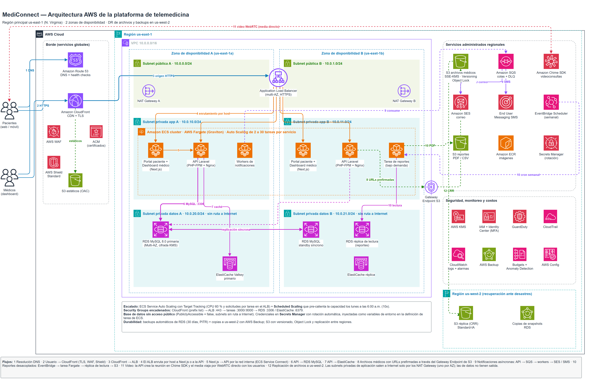
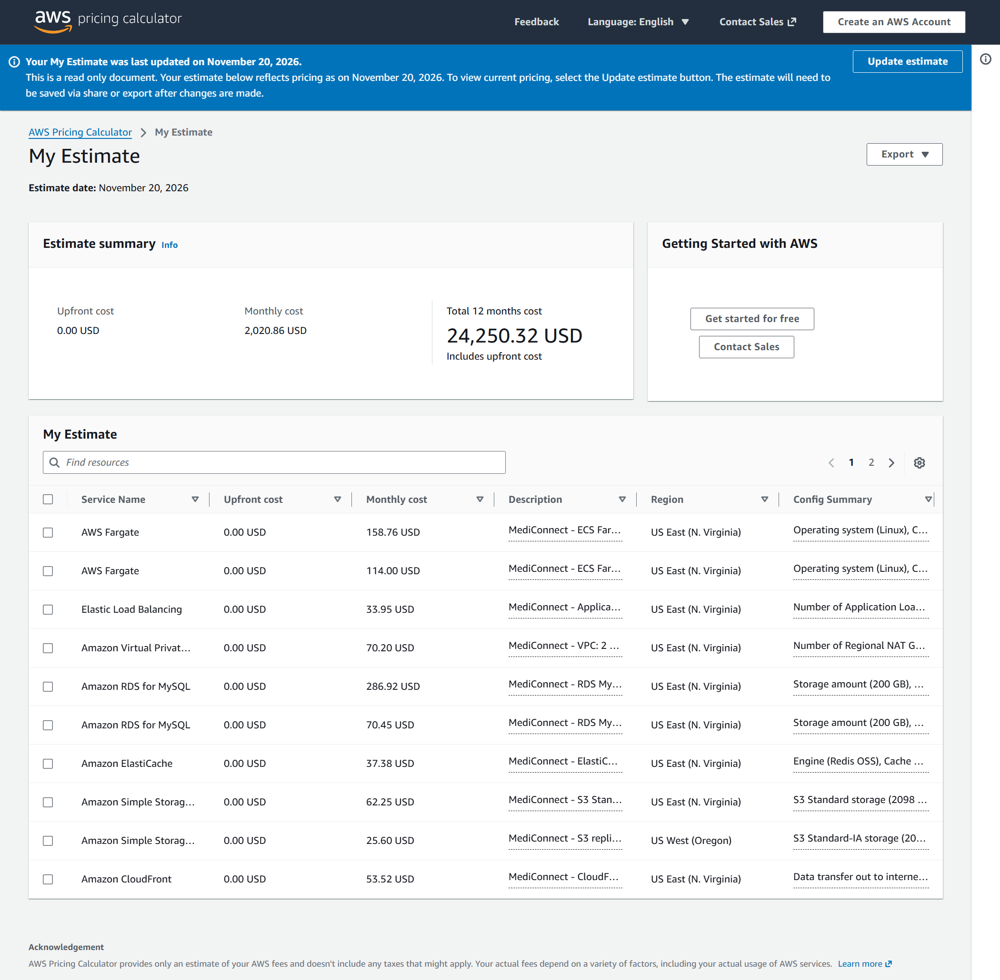

# ☁️ MediConnect en AWS: solución escalable de telemedicina

Propuesta de arquitectura en **Amazon Web Services** para migrar **MediConnect**, una plataforma salvadoreña de telemedicina (videoconsultas, historial clínico y recetas electrónicas), desde un servidor físico que colapsa los lunes hacia una infraestructura escalable, segura y de costos predecibles.

> Actividad evaluada: *Implementar soluciones escalables en la nube seleccionando los servicios de AWS adecuados según las necesidades del negocio.* Autor: **Darwin Flores**.

## 📦 Entregables

| Entregable | Archivo |
|---|---|
| Reporte técnico (Word) | [`reporte/MediConnect-Reporte-Tecnico-AWS.docx`](reporte/MediConnect-Reporte-Tecnico-AWS.docx) |
| Reporte técnico (PDF) | [`reporte/MediConnect-Reporte-Tecnico-AWS.pdf`](reporte/MediConnect-Reporte-Tecnico-AWS.pdf) |
| Diagrama de arquitectura (PNG, 4200 × 2600) | [`diagrama/mediconnect-arquitectura-aws.png`](diagrama/mediconnect-arquitectura-aws.png) |
| Diagrama de arquitectura (PDF) | [`diagrama/mediconnect-arquitectura-aws.pdf`](diagrama/mediconnect-arquitectura-aws.pdf) |
| Diagrama editable (draw.io, íconos oficiales AWS) | [`diagrama/mediconnect-arquitectura-aws.drawio`](diagrama/mediconnect-arquitectura-aws.drawio) |
| Estimación de costos (CSV / JSON) | [`costos/estimacion_costos.csv`](costos/estimacion_costos.csv) |
| Script reproducible del cálculo de costos | [`costos/calculo_costos.py`](costos/calculo_costos.py) |
| Estimación en AWS Pricing Calculator (enlace y captura) | [Enlace público](https://calculator.aws/#/estimate?id=df7356ab4e117667b5d852e69d005d81837bb747) · [`costos/aws-pricing-calculator.png`](costos/aws-pricing-calculator.png) |

El reporte incluye las 8 secciones solicitadas:

1. Resumen ejecutivo
2. Análisis de requerimientos
3. Propuesta de arquitectura AWS
4. Diagrama de arquitectura
5. Justificación de decisiones técnicas
6. Estrategia de seguridad
7. Estimación de costos
8. Conclusiones

## 🏗 Arquitectura



Para editar el diagrama, abre <https://app.diagrams.net>, elige **File → Open from → Device** y selecciona el archivo `.drawio`.

**Resumen de la solución** (región `us-east-1`, recuperación ante desastres en `us-west-2`):

| Capa | Servicios | Requerimiento que resuelve |
|---|---|---|
| Borde | Route 53, CloudFront, ACM, WAF, Shield | Carga < 2 s, seguridad |
| Red | VPC en 2 AZ, subnets públicas y privadas (app / datos), ALB, NAT Gateway, Gateway Endpoint de S3 | Alta disponibilidad, aislamiento de la base de datos |
| Cómputo | ECS sobre Fargate (Graviton) + ECR, auto escalado de 2 a 30 tareas y escalado programado los lunes | Escalabilidad 10x |
| Datos | RDS for MySQL Multi-AZ + réplica de lectura, ElastiCache (Valkey) | Disponibilidad, rendimiento |
| Archivos | S3 con SSE-KMS, versionado, Object Lock y replicación entre regiones | Almacenamiento altamente durable |
| Asíncrono | SQS + workers, EventBridge Scheduler + tarea Fargate de reportes | Reportes desacoplados de la API |
| Comunicación | Chime SDK (video), SES (correo), End User Messaging (SMS) | Videoconsultas y notificaciones |
| Seguridad y operación | Secrets Manager, KMS, IAM Identity Center, GuardDuty, CloudTrail, Config, CloudWatch, AWS Backup, Budgets | Seguridad de datos médicos, costos predecibles |

## 💰 Costos estimados (us-east-1, On-Demand)

| Concepto | USD/mes |
|---|---|
| Infraestructura base (cómputo, red, datos, seguridad) | ~1,054 |
| Costos por uso (videoconsultas, SMS, correo) | ~1,640 |
| **Total On-Demand** | **~2,694** |
| Total con Compute Savings Plan + RDS reservado (1 año) | ~2,545 |

Supuestos de volumen: 40,000 pacientes, 600 médicos, 15,000 videoconsultas/mes y hasta 600 solicitudes por segundo los lunes. El desglose por servicio está en la sección 7 del reporte y en [`costos/estimacion_costos.csv`](costos/estimacion_costos.csv).

Para regenerar el cálculo:

```bash
python costos/calculo_costos.py
```

> Los precios unitarios son los de lista On-Demand de AWS para us-east-1. La tarifa de SMS a El Salvador varía por operador y se estimó en US$0.10 por mensaje.

### AWS Pricing Calculator

La estimación está cargada en AWS Pricing Calculator (18 entradas, enlace público válido hasta noviembre de 2027):

**🔗 <https://calculator.aws/#/estimate?id=df7356ab4e117667b5d852e69d005d81837bb747>**

| Concepto | USD/mes |
|---|---|
| Servicios cargados en la calculadora | 2,020.86 |
| SMS a El Salvador (la calculadora no tiene tarifas SMS por país) | 600.00 |
| GuardDuty, AWS Backup, transferencia entre AZ, ECR y tarea de reportes | 58.11 |
| **Total conciliado** | **2,678.97** |

La diferencia con el script (2,694.35) es menor al 1 %. Se debe a que la calculadora aplica capas gratuitas en dashboards y health checks, cobra el primer millón de solicitudes SQS y no incluye la transferencia de replicación de S3.



## 📂 Estructura

```
.
├── reporte/    # Reporte técnico en Word y PDF
├── diagrama/   # Diagrama de arquitectura (.drawio, .png, .pdf)
└── costos/     # Script y resultados de la estimación de costos
```
